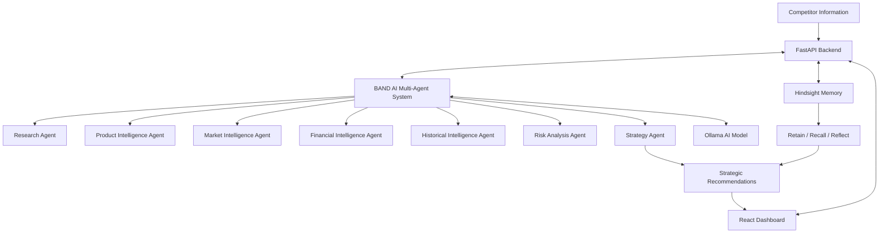

# CompeteIQ — System Architecture

## 1. Overview

CompeteIQ is a competitive intelligence platform developed by NEXORA AI. It combines a web dashboard, a Python backend, multi-agent collaboration, AI model processing, and long-term memory.

## 2. Architecture Diagram

## 3. Main Components

### Frontend
- Built using React and Vite.
- Displays competitor intelligence and strategic insights.
- Communicates with the backend API.

### Backend
- Built using Python and FastAPI.
- Handles API requests and application logic.
- Connects the frontend, agent system, and memory integration.

### BAND AI
- Coordinates specialized intelligence agents.
- Supports collaborative analysis and strategy generation.
- Uses the configured AI model through the worker.

### Hindsight
- Retains historical intelligence.
- Recalls relevant stored information.
- Reflects on past information to support better insights.

### Ollama
- Provides the locally configured AI model interface.

## 4. Information Flow

1. Competitor information enters the application.
2. The backend processes the request.
3. BAND AI coordinates the specialized agents.
4. The AI model supports agent analysis.
5. Hindsight stores and retrieves historical information.
6. The strategy component generates recommendations.
7. The frontend displays the results.

## 5. Important Note

This diagram describes the intended application architecture. Actual integration success depends on configuration, credentials, and runtime verification.